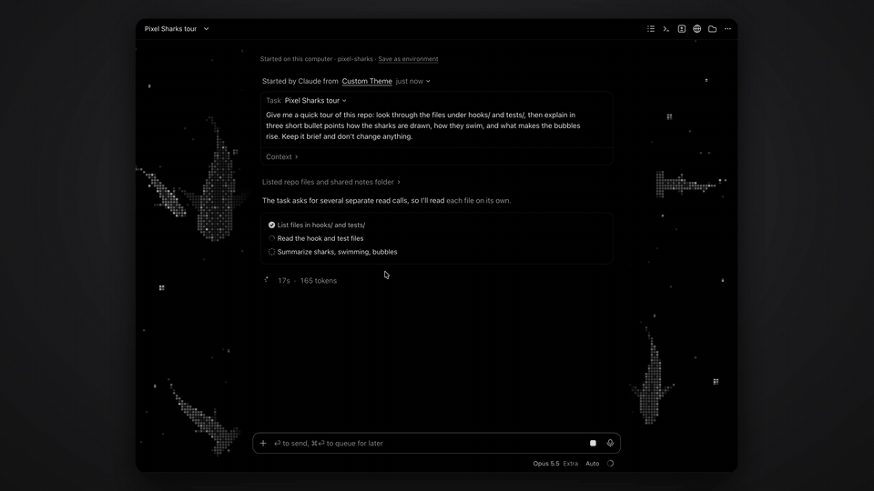

# Pixel Sharks

Top-down pixel-art sharks that swim behind your Claude Code chat and react to what Claude is doing.



## What it does

Four species swim on a black sea, drawn in dithered grey blocks: a great white, two hammerheads, a thresher and a whale shark. They swim in lanes either side of the chat column, sized for the main window with the sidebar open. In a narrower layout a shark can pass behind the chat, where the frosted glass blurs it so your text stays readable. The scene reacts to Claude:

| When | What happens |
|---|---|
| Claude runs a tool | Columns of bubbles rise from the sea floor and stay up for a few seconds |
| A Bash command fails | The sharks turn red and flee off the screen, then swim back |
| A turn is interrupted or fails | The sharks dim for a moment |
| You type in the prompt box | Sonar rings spread up from the bottom (if your app reports typing) |

The chat sits on dark frosted glass, so text stays easy to read.

## Install

At the prompt of a Claude Code session:

```
/plugin install pixel-sharks --marketplace toprakkara/pixel-sharks
```

Answer `y` to add the marketplace, then pick a scope.

From a shell:

```bash
claude plugin install pixel-sharks --marketplace toprakkara/pixel-sharks
```

In the desktop app, where `/plugin` does not run: click **+** next to the prompt box, then **Plugins**, **Add marketplace** with `toprakkara/pixel-sharks`, then **Add plugin**.

Then open a new session, or run `/reload-plugins` in an open one. Mods load once you trust the folder.

## Requirements and limits

- Claude Code **v2.1.323 or newer**.
- Shows in the Claude **desktop app** (Code tab) and the **mobile app**. The terminal and editor extensions don't draw backdrops.
- While it's on, the app switches to dark mode and this replaces any other theme.
- Plain SVG and CSS: no scripts in the scene and nothing loaded from the network.

To turn it off, disable or uninstall it from `/plugin`.

## How it works

It's a Claude Code mod. `hooks/register.tsx` listens to turn and tool events and keeps a small state. `hooks/scene.ts` draws the backdrop as one SVG:

- Each shark is rasterized once into whole blocks, with a straight and a diagonal drawing and two tail poses.
- The sharks move one block per step in eight directions. 90° turns keep every block on the grid.
- A fixed black grid on top opens the gaps between blocks.
- There are no SVG filters, because the app strips them when it sanitizes the scene.

Run the tests with `claude plugin test .`.

## Not affiliated with Anthropic

This is a community project. It is not an official Anthropic product and is not affiliated with or endorsed by Anthropic.

## License

[MIT](LICENSE) © 2026 toprakkara
